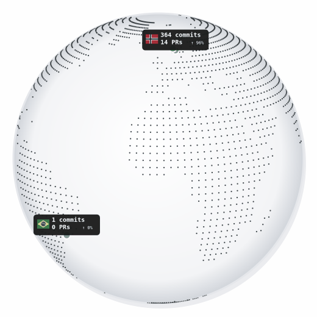

# github-contrib-globe-badge

A daily-updating GitHub contribution analytics badge showing where the owners of repositories you contribute to are located. Click the badge to open an **interactive Cobe globe** on GitHub Pages.

[](https://kveita.github.io/github-contrib-globe-badge/)

This is a standalone project that uses [Cobe](https://github.com/shuding/cobe), an external WebGL globe library, to render its interactive page. It is not a fork of Cobe.

## What it shows

The animated GIF badge shows a rotating dotted world map with country markers, flags, commit and PR counts, and each country's percentage of tracked contributions. Its flag and label are compact to minimize overlap. The globe completes one seamless rotation per loop. Clicking the badge opens the interactive version, where the globe can be dragged and zoomed. The interactive globe uses the same daily-generated `data.json` as the badge and displays the Cobe world map with flag emoji in its live marker labels. Contributions in the same country share one marker and one label with summed counts and links to all contributing repositories. Markers outside a recognized country are shown separately without a flag.

## How it works

1. GitHub Actions searches commits authored by the configured GitHub user since 2023, plus commits that credit the user through a `Co-authored-by:` trailer (matched by login or GitHub noreply/public email).
2. For each commit's repository, the generator resolves the true origin repository — following GitHub's fork `source` field, and falling back to a commits-search lookup (picking the oldest repository by creation date) to catch repositories that duplicate another repo's commit history without being a registered GitHub fork. Origins are cached per repository so this only runs once per distinct repository, not once per commit.
3. Commits are grouped by the origin repository's owner, and each owner's public GitHub profile location is geocoded with OpenStreetMap Nominatim. Country codes are determined from the world map's country polygons, falling back to Nominatim for coastal locations outside the polygons; the GIF renders flags from the MIT-licensed flag-icons assets.
4. The generator groups geocoded owners by country, using the first owner's location for the country's marker, then writes `badge.gif` for the animated profile badge and `data.json` for the interactive page.
5. GitHub Pages serves the root `index.html`, which loads Cobe in the browser and renders the interactive globe.
6. A daily workflow (`.github/workflows/badge-update.yml`) regenerates and commits the badge and shared analytics data.

## Adding the badge to a profile README

Fork the repository, then the workflow will automatically use your GitHub username to generate the badge. No changes to the workflow are needed.

Add the badge to your profile README using the linked-image Markdown below. Replace `kveita` with your GitHub username:

```markdown
[](https://<YOUR_USERNAME>.github.io/github-contrib-globe-badge/)
```

The outer link opens the interactive GitHub Pages globe in a new browser tab when the profile visitor clicks the badge link.

## Repository layout

```text
.
├─ index.html                         # interactive Cobe globe served by GitHub Pages
├─ data.json                          # generated contribution data consumed by index.html
├─ commit-cache-<owner>.json          # owner-specific attribution cache
├─ badge.gif                          # generated animated profile badge
├─ badge/generate-badge.js            # badge and analytics-data generator
└─ .github/workflows/badge-update.yml # daily generation and commit workflow
```

## Customising

The contribution date range is controlled by the `author-date:>2023-01-01` query in `badge/generate-badge.js`. The interactive page imports Cobe from jsDelivr and can be customised through the globe options and page styles in `index.html`.

## Development

```bash
npm install
# For local testing, set GITHUB_ACTOR to your GitHub username:
GITHUB_ACTOR=<YOUR_USERNAME> node badge/generate-badge.js
```

The generator writes `badge.gif`, `data.json`, and `commit-cache-<owner>.json`. Each owner has an independent cache; the workflow also restores and saves that cache through GitHub Actions Cache, which is scoped to the repository. Commit records store `ownerAtCommit` and the commit date. Repository owner observations and transfer boundaries are stored in the same cache under `_repositoryRedirectHistory`, keyed by GitHub's stable repository ID. For a fork, the generator seeds only transfer-history metadata from the source repository's committed cache into the fork's own cache; it does not copy the source's per-commit records or share its Actions cache. The generator checks prior repository names through the public REST API and compares the requested name with the final `full_name` after GitHub redirects the request; no audit-log or admin token is used. Existing `_repositoryOwnerHistory` entries are retained for cache compatibility.

Redirects show that a repository moved, but do not disclose the transfer timestamp. The cache's last successful old-owner observation and first redirect observation bound the transfer to an interval. Commits outside that interval can be assigned to an owner; a commit inside it uses its already cached per-SHA owner when available, otherwise it is skipped rather than attributed by guesswork. A fork can reuse transfer observations included in its source repository's committed cache, but it cannot reconstruct moves that were never cached there. If the source cache does not include the old repository name or transfer boundary, GitHub's public API provides no way to recover that missing history. In the GitHub Actions workflow, `GITHUB_ACTOR` is automatically set to `${{ github.repository_owner }}` (the fork owner), so no manual configuration is required. To update the committed badge and country codes from the existing `data.json` without querying GitHub again, run `node badge/generate-badge.js --render-only`.

GitHub Pages is configured to serve the repository's `main` branch root at:

<https://kveita.github.io/github-contrib-globe-badge/>

## Credits

The interactive globe rendering is powered by [Cobe](https://github.com/shuding/cobe) by [Shu Ding](https://github.com/shuding). Flag images for the GIF are from [flag-icons](https://github.com/lipis/flag-icons) (MIT). Cobe is credited here as a dependency; the contributors listed for this repository reflect its own commit history.

## License

MIT